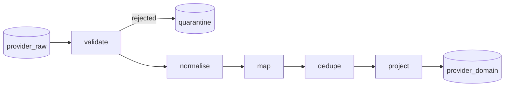
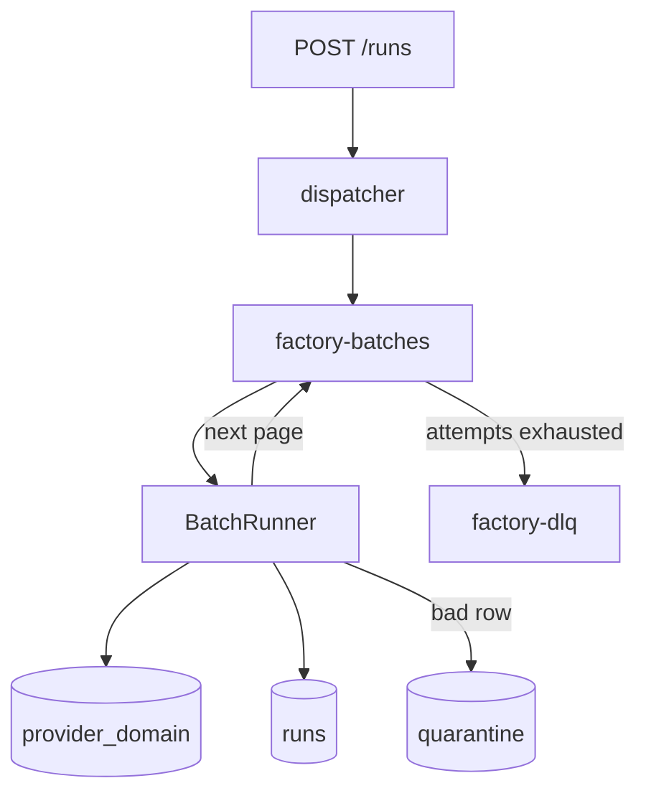

# Architecture

The raw database is a staging area for one provider export. The factory reads it, and writes a domain database other services can query. Adding a provider means a new adapter and a field map. The queue, the run record, and the upsert rules stay as they are.

Provider name in this slice: `xbyte`. The marketplace inside the export is Talabat (`domain: "talabat"`). That value is data, not a code branch.

## What the three collections actually are

All three are HTTP captures, not domain entities. Each document is one response: `domain`, `endpoint`, `params`, `payload`, `statusCode`, timestamps. `statusCode` is 200 even when the payload is an error. The payload is what matters.

| Raw collection | Documents | What a document is |
| --- | --- | --- |
| `locations` | 8 | One dump of the area catalogue. All 8 dumps are identical. 697 areas each. |
| `restaurants` | 70 | One page of a search in an area. Two areas: Al Zaab (`1468`, 54 pages) and Al Rowdah (`1461`, 16 pages). |
| `menus` | 500 | One attempt to fetch a single outlet's menu. `params` is just `{ restaurant_url }`. |

They do not overlap as samples. The menus were fetched for `aid=1280` (Dubai World Trade Center). The listing pages were fetched for 1468 and 1461. No public restaurant id appears in both. The join is by id, not by co-occurrence in this extract.

### Locations

`payload.results[]` is `{ location_id, location_name, location_slug }`. `location_id` is an int. 697 distinct ids.

Slug is not an id. 11 slugs are shared by 23 ids. `industrial-area` is three ids (1916, 3892, 5625), same name. `al-muntazah` is two ids whose names differ only by a double space (`Al  Muntazah` and `Al Muntazah`). Both rows are real. We keep both.

### Restaurant listings

A page is `params: { areaId, areaSlug, domain, page_no }` plus `payload.results[]` of `{ area_name, restaurant_name, restaurant_url }`.

1,011 result rows, 302 distinct outlets. The same outlet is repeated across pages (up to 12 times) and, for 161 outlets, across both search areas. The name does not vary. `area_name` on the row is the area that was searched, not the neighbourhood baked into the slug. `?aid=` on the URL matched `params.areaId` on every row.

Two pages are failures, both for Al Zaab, both with HTTP 200:

- page 3, on one of the duplicate fetches: `Page Error Message: "Page limit exceeded."` and `results: []`. `Total Page` on that response is 1, while sibling fetches of the same area say 227. The total is not trustworthy.
- page 14, on one fetch: `error: ""` and no results array.

Another page 14 sends `error: false` next to a normal result set. That is a flag, not a failure.

The public id is the number in `/restaurant/{id}/{slug}`.

### Menus

345 payloads have `results` of length 1. 155 have `Message: "This is not restaurant page (Talabat)."` and no results. 16 successful menus have an empty `category` array. That is still an outlet; it just has no sections.

Identity inside a successful menu, checked on all 345:

| Field | What it did in this extract |
| --- | --- |
| URL `/restaurant/{id}` | The id listings use. |
| `outletCode` | Equal to the URL id, 345 of 345. |
| `id` | Equal to the URL id, 0 of 345. A different number (Little Bangkok is URL `34807`, body `id` `1400`). |
| `?aid=` | A location id. All 345 point at 1280, which is in the catalogue. |

`outletCode` is the restaurant key. `id` is kept as `vendorId`. In this extract the two are 1:1, so we have not seen a chain. They are still different identifiers, and collapsing on `id` would merge two outlets the day a chain shows up.

Other drift on the profile:

- `deliveryFee` is a string (`"9"`, `"6.5"`, `"1.99"`). `rate` is an int on 31 menus and a float on 314.
- `latitude` / `longitude` are strings. All 345 parse, none are out of range.
- `Contact` is `00000-00000` on all 345. Placeholder.
- `DeliveryTime` is a label (`"25-40 mins"`, sometimes `"30 mins"`).
- `Minimum Order`, `Restaurant Address`, `City` use display-name keys. `category` is a nested array.

Categories and items:

- 4,195 categories, 31,102 item rows, 28,773 distinct `(outlet, item_id)` pairs.
- 2,266 items appear in more than one category of the same menu. The payload is identical each time. No item id is shared across outlets in this extract.
- 60 menus reuse a `category_id` for two sections with different names and, usually, different items (`Picks for you 🔥` and `Bites` sharing one id). Zero of those pairs collapse to the same name after trimming. So `category_id` is not unique inside a menu.
- 4,135 category ids also appear as item ids somewhere. They are not one id space.
- 1,631 images are null. 2,071 descriptions are blank. 1,985 prices are 0. Zero is common enough that it is a free item, not a missing price.
- Item names carry trailing spaces (`"SABUDANA VADA "`).

## Target model

Domain database `provider_domain`. The raw database is never written.

Natural keys are the `_id`. Upserts hit that key. Source timestamps are stored so an older snapshot cannot overwrite a newer one, whichever job finishes last.

### `locations`

Owns the area catalogue.

| Field | Notes |
| --- | --- |
| `_id` | `location_id` as a decimal string. `"1468"` matches listing `areaId` and menu `aid`. |
| `name`, `slug` | Name is trimmed and internal whitespace is collapsed. Slug is not unique. |
| `channel` | The `domain` value, `talabat`. |

Indexes: `_id` unique. `slug` not unique, because of the 11 collisions. It is there so a lookup by slug stays cheap and so nobody is tempted to unique it later.

### `restaurants`

One outlet. Fed by listings and by menus. They own different fields.

| Field | Written by |
| --- | --- |
| `_id`, `publicId` | URL id / `outletCode`. |
| `name`, `slug` | Menu profile when we have one, otherwise the listing card. |
| `listingName`, `listingSlug` | Listing only. A listing never replaces a menu name. |
| `vendorId` | Menu body `id`. |
| `logoUrl`, `city`, `address`, `phone` | Menu. Phone is null when the value is only zeros and separators. |
| `rating`, `reviewCount`, `ratingCount` | Menu. Zero is kept. |
| `deliveryFee`, `minimumOrder` | Menu, numbers. |
| `deliveryTimeLabel` | Menu, the original label. Not parsed into a window. |
| `coordinates` | GeoJSON point. Longitude first. |
| `profileUpdatedAt`, `profileSourceId` | Which menu snapshot won. |
| `listingUpdatedAt`, `listingSourceId` | Which listing snapshot won. |

Indexes: `vendorId` (not unique). `coordinates` as a partial 2dsphere, only where `coordinates.type` is `Point`, so a listing-only outlet is not forced through the geo index.

### `restaurant_service_areas`

An outlet is offered in many areas. 161 outlets showed up in both Al Zaab and Al Rowdah. The area is not a column on the restaurant.

`_id` is `{publicId}:{locationId}`. Fields are those two ids and `channel`. Listing pages contribute the search `areaId`. Menus contribute `aid`. The link is a reference, not a copy of the location name. The name lives on `locations`.

Indexes: `locationId`, `restaurantPublicId`.

### `menu_categories`, `menu_items`, `menu_placements`

A category is not "the category id". The key is `{publicId}:{categoryId}:{hash of the normalised name}`. The hash is 16 hex chars of SHA-256, so emoji in names like `Picks for you 🔥` do not have to be escaped into the id. The display name is a normal field.

An item key is `{publicId}:{itemId}`. One row, even when the item is filed under two sections.

A placement is `{categoryKey}:{itemId}` plus `position` (the index in that section's array). This is the collection that would have been an embedded array, and it is the one place the embedding loses. The same item sits in several sections, order inside a section matters, and `category_id` collides, so "item ids embedded on the category" either duplicates the item or points at an id that is not unique. The placement row is the pair.

Indexes: `restaurantPublicId` on all three. `categoryKey` on placements.

Categories, items and placements are owned by one menu snapshot. After a menu is applied, rows for that outlet whose source timestamp is strictly older than the winning menu are deleted. An older job that runs later inserts its extras and then deletes them again, because the cleanup reads the winning timestamp back from the restaurant. Service areas are not deleted. A menu fetched for one `aid` is not evidence that the outlet stopped being listed in another area.

## Trade-offs

- **Reference, not embed, for areas and for items.** Both are many-to-many and both are queried from either side. Embedding the menu into the restaurant would copy 2,266 items and would make "items in this section, in order" a scan.
- **Embed nothing inside the placement.** It is only a key, a position, and the source rank. The item body lives once.
- **Do not invent a brand collection.** `vendorId` never repeated. Promoting it now would be a collection with one outlet each. The field is there so the promotion is a backfill, not a migration of the key.
- **Do not drop zero prices, null images, or blank descriptions.** They are normal in this extract. A negative price or an unparseable coordinate quarantines that item or that menu.
- **Placeholder phone becomes null.** Serving `00000-00000` as a phone number is worse than a null. The raw document is untouched.
- **Listing name does not win over a menu name,** even if the listing document is newer. A search card is a partial projection. It fills `name` only while no menu profile exists.
- **Same input does not delete a service area.** Removal of an area that disappeared from a later export is not implemented. Menu children are replaced, because a menu snapshot is a full picture of that outlet's sections. A listing page is not a full picture of the outlet's areas.

## Pipeline

Every raw document goes through the same five stages. The stages are functions. The batch runner calls `adapter.transform` and does not know a field name.

1. **validate.** Envelope has an id, a timestamp, a domain, and an object payload. A provider error with no rows stops here: the Talabat "not a restaurant page" message, "Page limit exceeded." with an empty `results`, `error: ""` with no rows. `error: false` beside real rows is ignored. `statusCode` is ignored.
2. **normalise.** The field map coerces types. Labels are trimmed and internal whitespace collapsed, case and emoji kept. Ids become canonical decimal strings. Fees and coordinates are parsed. The placeholder phone becomes null. A bad child row (a listing URL with no id, an item with a negative price) is quarantined on its own and the rest of the document continues.
3. **map.** Normalised rows become restaurants, areas, categories, items, placements. The public id comes from the URL, and for a menu it must equal `outletCode`. A mismatch is a quarantine, not a guess.
4. **dedupe.** Inside the document, and then again across the batch: one write per natural key, newer source timestamp wins, source id breaks the tie. The skipped counter is these collapsed duplicates.
5. **project.** Writes carry the source rank. The store turns that into a Mongo pipeline update.

A document that fails validation counts as `failed` and not `transformed`. A document that is accepted counts as `transformed`, and any bad child rows also count as `failed`. `written` is upserts issued after dedupe, not "documents whose bytes changed". `read` is raw documents fetched.

Quarantine stores the run id, job id, source id, stage, and reason. It does not store the payload. Endpoints in this export carry a provider credential, and a menu payload is large. The reason is enough to find the raw document.

## Queue

One job is one page of one collection: `{ runId, collection, afterId, limit }`. The id is `runId__collection__afterId`. BullMQ rejects a custom id that contains `:`.

The dispatcher enqueues the first page of each selected collection. The worker reads `_id > afterId`, sorted, limited. It does not use `skip`, and it does not load the collection. When the page is full it enqueues the next page. A short page, or a page that hits `limitPerCollection`, marks that collection done. An exactly-full last page is followed by one empty read; that empty read is how the cursor knows it reached the end.

Job options: attempts and exponential backoff from the environment, concurrency from `WORKER_CONCURRENCY`, lock duration 120s so a fat menu page is not marked stalled.

Two failure paths, on purpose:

- A bad document is quarantined. The job succeeds.
- A thrown error (Mongo or Redis down, a bug) retries with backoff. The last attempt is copied to `factory-dlq` and the run is marked `failed`. Sibling pages already queued still finish. The run does not flip back to `completed`.

Counters and the checkpoint are one update, filtered on the cursor this job started from. A retry whose cursor has already moved does not increment again and cannot move the cursor backwards. Re-applying the page is safe because every write is an upsert that only replaces a row when the incoming source is newer or the same source.

On process start, runs still in `running` are reattached. A job that is waiting or active is left to BullMQ. A job that is missing, or that already exhausted its attempts, is queued from the checkpoint, not from the first page. Killing a worker therefore replays at most the in-flight page. A run that has been marked `failed` is not restarted on its own. `POST /runs` again over the same raw data produces the same domain state.

Operational collections `runs`, `quarantine` live in the domain database. They are not domain entities. A third database would have been ceremony at this size.

## Where a second provider plugs in

`ProviderAdapter` is the seam. `provider-registry.ts` maps a name to an instance. `PROVIDER=xbyte` resolves it at boot and the process exits if the name is unknown. The adapter declares its raw collection names and a `transform` function. The xbyte field tables live in `src/providers/xbyte/mapping.ts`. A provider with the same envelope and different column names replaces that table. A provider with a different envelope adds a class and a registry line. The runner, the stores, and the HTTP routes do not change.

## Configuration

The process validates the environment with Zod before it listens. A bad `MONGO_URI`, a non-integer batch size, or `RAW_DB` equal to `DOMAIN_DB` aborts startup. There is no localhost default for the database or Redis. Defaults exist for port, batch size, attempts, and the provider name, and they are in the schema rather than buried in the code that uses them.
